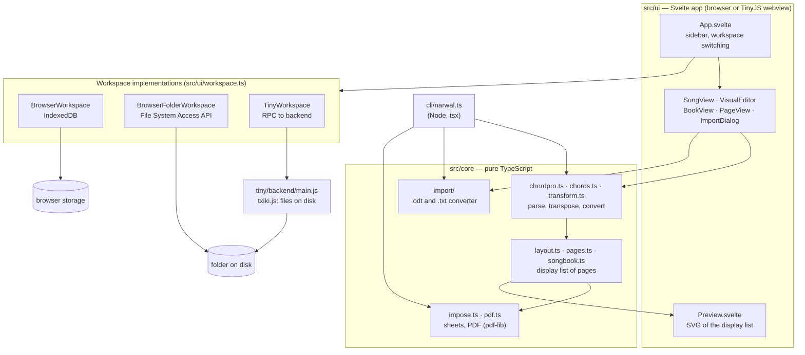

# Technical overview

How Singing Narwal is built, how it stores files, and how it is distributed. For using the
app, see the [README](../README.md); for working on the code, see the
[developer guide](DEVELOPMENT.md).

## Architecture

One TypeScript codebase runs in three places: the browser, a TinyJS desktop app and the
command line. Everything that understands songs and draws pages is in `src/core/`, plain
TypeScript with no browser or Node dependencies. The UI and the CLI are thin layers on
top, and files are reached through a small `Workspace` interface with one implementation
per kind of storage.



### Rendering pipeline

```
 .cho ──parse──▶ SongDoc ──layout──▶ pages (display list) ──┬──▶ SVG preview
                                       ▲                    └──▶ impose ──▶ PDF (pdf-lib)
 .songbook.yaml ──────── assemble ─────┘   (index, page numbers, blanks, images, pages)
 .page.yaml ──────────── layoutPage ───┘
```

- **Parsing** (`chordpro.ts`) keeps one entry per source line, so a song can be edited and
  written back without losing anything. Chords are stored as positions in the lyric text,
  which is what keeps them anchored to letters while the text changes.
- **Layout** (`layout.ts`) measures text with the real font files (fontkit) and produces a
  *display list*: positioned text, lines, rectangles and images per page. Chords that would
  collide are spaced out (with a hyphen when a word is split), long lines wrap,
  paragraphs are kept together. Auto-fit tries one and two columns and text scales from
  100% down to 75%, and keeps the result with the fewest pages, then the largest text with
  the fewest wrapped lines.
- **Assembly** (`songbook.ts`) lays out each item of a songbook, starts 2-page songs on a
  left page, numbers pages on the outer corners, builds the index once page numbers are
  known, and pads booklets to a multiple of 4 before a final back cover.
- **Imposition** (`impose.ts`) places pages on sheets: one per sheet, two copies per sheet,
  two pages per sheet, or saddle-stitch booklet order.
- **Output:** the preview draws the display list as SVG, and `pdf.ts` draws the same list
  into a PDF with embedded font subsets. Both come from the same data, so the preview
  matches the printout.

### Import pipeline

`src/core/import/` turns "chords on the line above the lyrics" into ChordPro:

1. **Read** the document into lines of characters with x-positions. For `.odt`
   (`odt.ts`, unzipped with fflate, parsed with a small XML reader in `xml.ts`), styles,
   spaces, tabs and indents are resolved and every character is measured with the
   closest bundled font; for `.txt` (`index.ts`), columns are monospaced.
2. **Convert** (`sheet.ts`): classify chord lines and lyric lines, attach each chord to
   the letter under it (moving it to the next word if it sits on a space), and recognise
   titles, artists, instrumental lines, indented choruses, `Rit.` labels and chorus repeats.

## Technologies

| Area | Choice | Why |
|---|---|---|
| Language | TypeScript | one codebase for browser, desktop and CLI |
| UI | Svelte 5 (runes) | small bundle, approachable code for contributors |
| Build | Vite | fast dev server; builds a static site with relative paths |
| PDF | pdf-lib + @pdf-lib/fontkit | PDFs generated in the app, fonts embedded, no server or native code |
| Zip and `.odt` | fflate | unzips `.odt`, makes and reads `.zip` backups |
| Songbooks and pages | YAML (`yaml`) | readable and editable by hand |
| Songs | ChordPro | existing plain-text format that already anchors chords to letters |
| Desktop | TinyJS (system WebKit + txiki.js backend) | about 6 MB, no Electron |
| CLI | Node + tsx | runs the TypeScript sources directly |
| Tests | Vitest | unit tests of `src/core` |
| Fonts | Liberation Serif, Sans, Mono (SIL OFL) | LibreOffice's defaults, metric-compatible with Times New Roman, Arial and Courier, so imported documents measure exactly |

## File formats

A workspace is a plain folder:

```
canzoniere/
  campo-2026.songbook.yaml
  pages/
    copertina.page.yaml
  songs/
    aquile-randagie.cho
    strade-di-coraggio.cho
  images/
    logo.png
  fonts/                  # optional: extra .ttf/.otf fonts, usable in pages
    Amatic-Bold.ttf
```

Keep songbooks at the top of the workspace: the paths inside them are relative to the
songbook file. All files are UTF-8 text except images and fonts.

### Songs: ChordPro (`.cho`)

[ChordPro](https://www.chordpro.org/), with chords inline in square brackets right before
the letter they belong to:

```
{title: Aquile Randagie}
{artist: Cisco Bellotti}
{key: D}

[D]Siamo Aquile ran[G]dagie
che [A]volano in alto nel [D]cielo

{start_of_chorus}
[A]Estote parati, estote parati
è il [Bm]grido che abbiamo in gola
{end_of_chorus}

{chorus}

Intro: [D] [G] (2x)
```

| Syntax | Meaning |
|---|---|
| `[Am]` before a letter | chord on that letter; English or Italian names (`Am`, `Lam`, `La-`, `LA-`) |
| a line with no lyrics, only chords, a `Label:`, `(notes)` and symbols (`\|`, `x2`) | instrumental line, chords printed inline |
| `{start_of_chorus}` … `{end_of_chorus}` | chorus (indented); also `verse`, `bridge`, `tab` |
| `{start_of_chorus: Rit.}` | chorus with a label in the margin |
| `{chorus}` | repeat the last chorus: prints its first line + "…" |
| `{comment: …}` | italic note |
| `{column_break}`, `{new_page}` | force a break |
| `{columns: 2}` | number of columns for this song (songbooks may override it) |
| `# …` | comment line, not printed |

Unrecognised chords (`N.C.`, `|`, `x2`) are printed as written and never transposed.
Converting the notation or transposing rewrites the chords in the file. Minor chords keep
the sign they were written with (`Lam` → `Sim`, `La-` → `Si-`); converting to Do Re Mi
writes `Am` as `Lam`, and converting to C D E writes `Lam` and `La-` as `Am`.
Transposition spells accidentals for the new key (D+1 → E♭, not D♯), using `{key}`.

### Songbooks (`.songbook.yaml`)

```yaml
title: Canzoniere Campo 2026
page: A5               # A4 | A5 | A6 | Letter | "Half Letter"
imposition: booklet    # booklet | 2up | single | copies
notation: original     # original (chords as written) | italian | english
columns: auto          # auto | 1 | 2
style:                 # optional, only what differs from the defaults
  lyrics: { size: 11 }
  chords: { size: 9.5 }
contents:
  - page: pages/copertina.page.yaml
  - toc: Indice
  - song: songs/al-fuoco-di-bivacco.cho
  - song: songs/insieme.cho
    columns: 2
  - blank
  - image: images/foto.jpg          # full-page image
  - page: pages/citazione.page.yaml # last page = back cover
```

Other options: `show_chords`, `page_numbers`, `keep_spreads` (start 2-page songs on a
left page), `fold_line`. A `page` item accepts `page_number: true` to number that page.

### Pages (`.page.yaml`)

Non-song pages (cover, quote, notes, ruled pages): a list of elements stacked from top to
bottom. A height of `fill` shares the space left on the page.

```yaml
elements:
  - text: "{{title}}"            # placeholders: {{title}}, {{year}}, {{date}}
    font: LiberationSans-Bold    # any bundled font or a font from fonts/
    size: 34
    align: center
  - image: images/logo.png
    height: fill
  - box: "Nome:"                 # rounded box with a label
    height: 46
    radius: 10
```

| Element | Options |
|---|---|
| `text` | `font`, `size`, `align`, `line_height`, `indent` |
| `image` | `height` (pt or `fill`), `width` (fraction of the page width), `align` |
| `box` | label; `height`, `radius`, `line_width`, `font`, `size`, `align` |
| `lines` | number of ruled lines or `fill`; `spacing` |
| `space` | height in points, or `fill` |
| `rule` | horizontal line; `line_width` |

All elements except `space` accept `margin` (space above, in points). New pages start
from built-in templates (`starterTemplate` in `pages.ts`). `{{title}}` is replaced with the
title of the songbook the page is printed in.

## Storage

All file access goes through the `Workspace` interface (`src/ui/workspace.ts`): `list`,
`readText`, `readBytes`, `writeText`, `writeBytes`, `remove`, `rename`. Paths are relative
to the workspace root with `/` separators.

| Implementation | Used by | Where files are | Notes |
|---|---|---|---|
| `TinyWorkspace` | desktop app | a folder on disk | each call goes to `tiny/backend/main.js` over TinyJS's RPC (`tiny.api.call`); paths containing `..` are refused |
| `BrowserFolderWorkspace` | website in Chrome/Edge | a folder on disk | File System Access API (`showDirectoryPicker`); needs HTTPS or localhost |
| `BrowserWorkspace` | website, by default | IndexedDB | empty on first use |
| `NoWorkspace` | startup | nowhere | placeholder until the real workspace is open; refuses writes |

### Browser storage (IndexedDB)

- Database `narwal-db` (`src/ui/idb.ts`) with two stores: `files` (path → bytes) and
  `meta` (backup times, the remembered folder handle, a "seeded" flag marking that the one-time setup ran).
- All files are loaded into memory when the workspace opens; reads are served from
  memory. A write resolves only after the IndexedDB transaction commits, and **throws** if
  the browser refuses it, so the app never reports a failed save as saved.
- When it opens, the workspace checks `navigator.storage.persisted()`. If the data is not
  protected yet, the first write of a session calls `navigator.storage.persist()`, asking
  the browser not to evict it under storage pressure. While protection is granted the
  sidebar says "Protected from automatic deletion". The Safari 7-day warning stays: Apple
  does not document whether persistence exempts a site from it.
- Earlier versions used `localStorage`, then a database named `narwal-score`; their data
  is moved to `narwal-db` once, and the old storage is removed.
- Without IndexedDB (some private windows), files are kept in memory only and the sidebar
  says so.
- The data belongs to one origin (scheme + host + port). Sites under a shared origin,
  such as several projects on `username.github.io`, share it: serve the app from its own
  domain or subdomain.

**Lifetime.** Data survives reloads and browser restarts. It is deleted by private-window
closing, by clearing site data, by Safari after 7 days without a visit
(Intelligent Tracking Prevention), and possibly by eviction when the disk is full and
persistence was not granted.

**Backups.** `BrowserWorkspace` records the time of the last change and the last backup
(a `.zip` download or a copy to a folder) in `meta`; the sidebar shows them. **Open a
.zip…** restores a backup; a zip of a folder (as made by the Finder) has its single
top-level folder removed, and `__MACOSX`, dotfiles and unknown file types are skipped.

### Folders in the browser

The handle of the folder picked with **Open folder…** is stored in IndexedDB. At startup
the app asks the browser whether permission is still granted (`queryPermission`); if so it
reopens the folder directly, otherwise it shows **Reopen folder**, which calls
`requestPermission` (this needs a click). **Work in browser storage instead** forgets the
folder.

### Desktop app

The desktop app never uses the webview's own storage. At startup it reads the last folder
from TinyJS's settings store (`tiny.store`, kept in
`~/Library/Application Support/org.narwal.app/`). If there is none, or it no longer
exists, it creates `<Documents>/SingingNarwal` (from `tiny.app.paths()`) and uses that.

### Saving

Editors save automatically a moment after the last change (`debouncedSaver` in
`src/ui/saves.ts`) and flush pending saves when they close. Renames and deletes wait for
pending saves, and update the songbooks that refer to the file (`src/ui/fileops.ts`).
Failed saves are reported in a red error bar.

## Distribution

### Website

`npm run build` writes a static site to `dist/` with relative paths (Vite `base: './'`),
so it can be served from any host and any sub-path: GitHub Pages, Netlify, a group's web
space. There is no server code and nothing is uploaded: files stay on the user's computer.

- Serve over **HTTPS**: browsers only allow folder access (File System Access API) in
  secure contexts.
- Prefer a **dedicated origin** (own domain or subdomain), so browser storage is not
  shared with other sites.
- Changing the address later means users' browser storage is left behind at the old one;
  they can move it with **Download all (.zip)** and **Open a .zip…**.
- There is no offline mode (no service worker) yet.

### Desktop app (TinyJS)

`tinyjs.json` configures the app (its name in `"title"`, which the web build and the CLI
also read; id `org.narwal.app`; icon `assets/narwal-logo.png`), the frontend (`npm run build`,
served from `dist/`) and the backend (`tiny/backend/main.js`, run by txiki.js).

- The launcher loads the page from `file://` in the system WebKit. Local reads with
  `fetch` succeed with status 0 there, which the font loader accepts.
- The backend exposes file operations on the workspace folder (list, read, write, rename,
  remove), plus reading and writing files the user picked in native dialogs.
- `tinyjs build --dmg` produces a `.dmg` in `.build/`. By default it runs only on the CPU
  type of the Mac that built it; it is signed ad-hoc, so macOS warns about an unidentified
  developer unless a Developer ID is configured (`signIdentity`). Updates are not set up yet.

### Command line

`cli/narwal.ts` renders songs and songbooks to PDF and converts `.odt`/`.txt` files to
ChordPro, using the same `src/core` code with fonts read from `public/fonts/`. See the
[developer guide](DEVELOPMENT.md#command-line).

### Web app and desktop app compared

| | Website | Desktop app |
|---|---|---|
| Storage | IndexedDB, or a folder (Chrome/Edge) | always a folder |
| Data loss risks | private windows, clearing site data, Safari's 7 days, eviction | none from the app |
| Folder access | permission may be asked again on each visit | no prompts; full path shown |
| Dialogs | browser file picker / download | native macOS panels (no suggested file name when saving) |
| Updates | immediate on reload | new `.dmg` |
| Installation | none | `.dmg`; unsigned builds trigger a macOS warning |
| Platforms | any modern browser | macOS (built per CPU type unless configured) |
| Offline | no | yes |

## Licences

The app is GPL-3.0-or-later. Dependencies (pdf-lib, @pdf-lib/fontkit, fflate, yaml,
Svelte) are under MIT, ISC or similar permissive licences, compatible with the GPL. The
bundled Liberation fonts are under the SIL Open Font License 1.1
(`public/fonts/LICENSE-Liberation.txt`).
